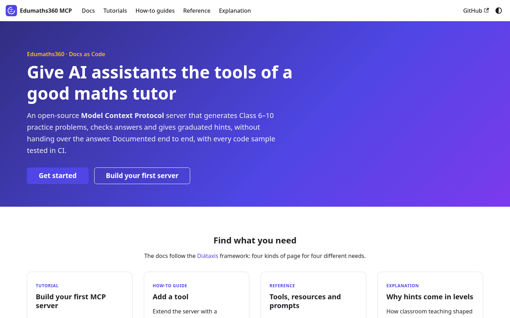
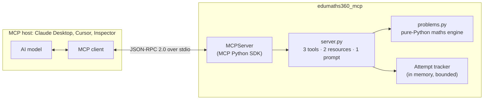
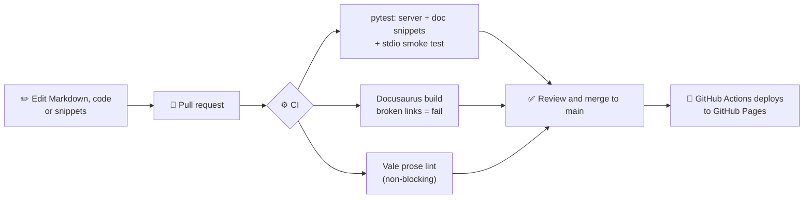

# 🧮 Edumaths360 MCP Docs — a Docs-as-Code Developer Hub for a Maths-Tutor MCP Server

[](https://github.com/Creator-hub24/edumaths360-mcp-docs/actions/workflows/ci.yml)
[](https://github.com/Creator-hub24/edumaths360-mcp-docs/actions/workflows/deploy.yml)


**A working [Model Context Protocol](https://modelcontextprotocol.io) (MCP) server that turns an AI assistant into a patient maths tutor for Class 6–10, plus the developer documentation hub I would want if I were integrating it.** The server generates practice problems, checks answers with feedback that names the mistake, and gives graduated hints without handing over the answer. The docs follow the Diátaxis framework, are built from the same repository, and are tested in CI so the code on the page always matches the code that runs.

### 🌐 Live docs: **[creator-hub24.github.io/edumaths360-mcp-docs](https://creator-hub24.github.io/edumaths360-mcp-docs/)**

> ⚠️ **Honest note:** this is a portfolio project. The server is fully working and tested, but it is not yet used by Edumaths360 students in production, and no learning outcomes have been measured. The walkthrough video is a labelled placeholder until it is recorded.



## 🏗️ Architecture



| Capability | Name | What it does |
| --- | --- | --- |
| 🛠️ Tool | `generate_problem` | Creates a problem for a topic, class and difficulty. Returns a stable ID, never the answer. |
| 🛠️ Tool | `check_answer` | Marks an answer, diagnoses common misconceptions, reveals the worked solution only after 3 tries. |
| 🛠️ Tool | `get_hint` | Three levels of hint, from "which method?" to "do the last step". Tested never to state the answer. |
| 📚 Resource | `syllabus://topics`, `syllabus://grade/{grade}` | The syllabus as JSON, overall and per class. |
| 💬 Prompt | `socratic_tutor` | A tutoring session that asks guiding questions instead of giving answers. |

Topics: linear equations, fractions, percentages and quadratics, across Class 6–10.

## 📚 What's in the docs (Diátaxis)

| Section | Pages |
| --- | --- |
| **Start** | Introduction (with video placeholder) |
| **🎓 Tutorials** | Build your first MCP server in 10 minutes · Connect the server to Claude Desktop |
| **🧰 How-to guides** | Add a new tool · Connect from a Python client · Configure Claude Desktop and Cursor · Debug with the MCP Inspector |
| **📖 Reference** | Tools · Resources and prompts · Configuration · JSON-RPC examples (15 real captured messages) |
| **💡 Explanation** | How MCP works · Architecture · Security model · Hint pedagogy |
| **🩺 Help** | Troubleshooting (real errors only) · Why I built this |

## 🚀 Quickstart

You need Python 3.10+ and [uv](https://docs.astral.sh/uv/).

```bash
git clone https://github.com/Creator-hub24/edumaths360-mcp-docs.git
cd edumaths360-mcp-docs/server
uv sync --extra dev                    # install the server and test tools
uv run pytest -q                       # 461 tests
uv run python ../snippets/client.py    # a full practice round from a Python client
```

Connect it to Claude Desktop by adding this to `claude_desktop_config.json`, then restart Claude Desktop:

```json
{
  "mcpServers": {
    "edumaths360": {
      "command": "uv",
      "args": ["--directory", "/absolute/path/to/edumaths360-mcp-docs/server", "run", "edumaths360-mcp"]
    }
  }
}
```

Preview the docs locally (Node.js 22):

```bash
cd docs-site && npm ci && npm start
```

## 🔁 Docs-as-code workflow



How the docs stay accurate:

- **Code is imported, not pasted.** Pages load examples from `snippets/` at build time with `raw-loader`, and `server/tests/test_snippets.py` runs those same files.
- **Outputs are captured, not typed.** `snippets/capture_payloads.py` records a real session; the JSON-RPC reference page renders that file directly.
- **Broken links break the build.** `onBrokenLinks`, `onBrokenAnchors` and broken Markdown links are all set to `throw`.
<!-- vale off -->
- **Prose is linted.** Vale enforces the [style guide](STYLE_GUIDE.md): plain English, no "simply" or "obviously", consistent product names.
<!-- vale on -->

## 🧑‍💼 Skills demonstrated (for hiring managers)

| Area | Evidence in this repo |
| --- | --- |
| **Developer documentation** | 17-page Diátaxis site: tutorials, task guides, complete reference, conceptual explanations, real-error troubleshooting |
| **Docs as code** | Docusaurus + MDX, Mermaid diagrams, code imported from tested files, strict link checking, Vale prose linting, CI/CD to GitHub Pages |
| **API / protocol knowledge** | MCP tools, resources and prompts; JSON-RPC 2.0 messages; tool errors vs protocol errors; stdio transport; protocol version negotiation |
| **Python engineering** | Typed MCP server on the official SDK 2.x, Pydantic output schemas, 461 pytest tests (unit, in-memory client, stdio subprocess), ruff |
| **Security thinking** | Schema validation, prompt-injection defence for prompt arguments, bounded memory, least privilege, honest limits |
| **Developer experience** | Copy-paste quickstarts with OS tabs, Python/JSON tabs, host configs for Claude Desktop and Cursor, Inspector workflows |
| **Domain expertise** | Hint levels, misconception feedback and reveal policy designed from Class 6–10 teaching practice |
| **Writing for a global audience** | Plain-English style guide written for readers of English as a second language |

## 📂 Repository structure

```text
edumaths360-mcp-docs/
├── server/                     # The MCP server (Python package: edumaths360-mcp)
│   ├── src/edumaths360_mcp/
│   │   ├── server.py           # Tools, resources, prompt (MCP layer)
│   │   └── problems.py         # Maths engine: generate, check, hints (no MCP imports)
│   ├── tests/                  # 461 tests: maths, MCP client, stdio, doc snippets
│   └── pyproject.toml
├── snippets/                   # Code quoted in the docs, run by the tests
│   ├── tutorial/times_table_server.py
│   ├── extend_server.py        # "Add a new tool" example
│   ├── client.py               # Python client walkthrough
│   ├── capture_payloads.py     # Records real JSON-RPC traffic
│   └── example_payloads.json
├── docs-site/                  # Docusaurus site
│   ├── docs/                   # tutorials/ how-to/ reference/ explanation/ + intro, troubleshooting
│   ├── src/                    # Homepage and React components
│   └── docusaurus.config.ts
├── .github/
│   ├── workflows/ci.yml        # pytest + ruff, docs build, Vale
│   ├── workflows/deploy.yml    # GitHub Pages deployment
│   └── vale/                   # Custom Vale style and vocabulary
├── assets/docs-screenshot.png
├── CONTRIBUTING.md
├── STYLE_GUIDE.md
└── LICENSE
```

## 🛠️ Tech stack

Python 3.12 · MCP Python SDK 2.x · Pydantic · pytest · uv · ruff · Docusaurus 3 (React, TypeScript, MDX) · Mermaid · Vale · GitHub Actions · GitHub Pages

## 🎥 Video walkthrough

> 🎬 **Placeholder:** a walkthrough video (under 3 minutes) is planned and has not been recorded yet, so there is no link here.

## 🤝 Contributing

See [CONTRIBUTING.md](CONTRIBUTING.md) and the [style guide](STYLE_GUIDE.md). Issues about unclear docs are as welcome as bug reports.

## 👤 Author

**Vaibhav Gupta**, founder of Edumaths360, maths teacher (Class 6–10), moving into developer relations and technical content. 📧 [Edumaths360@gmail.com](mailto:Edumaths360@gmail.com)

Licensed under the [MIT License](LICENSE).
