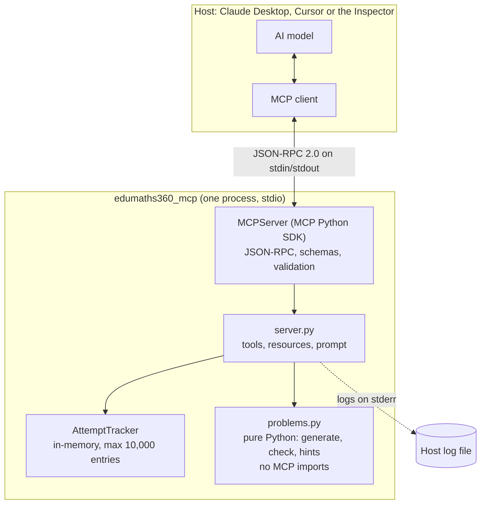
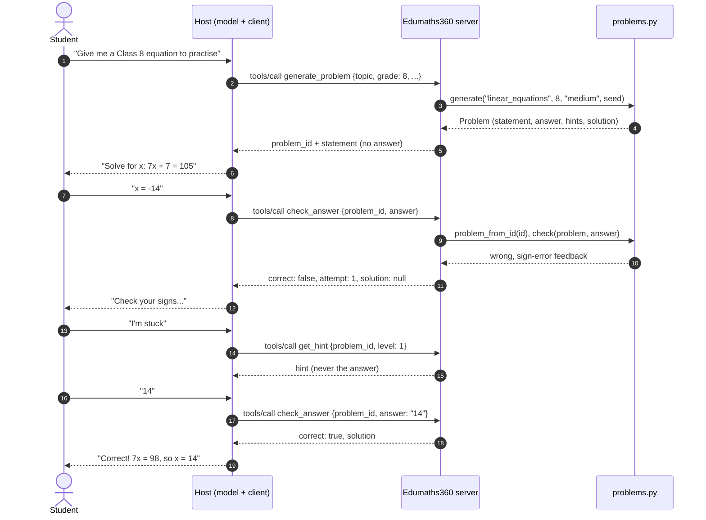
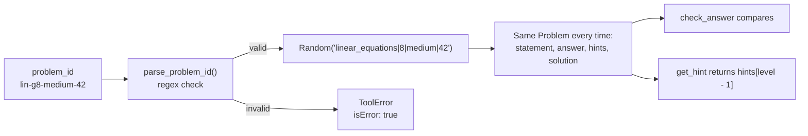

# Architecture

The server is about 370 lines of protocol code on top of about 560 lines of pure maths. This page explains how the parts fit together and why they are split this way.

## Components

| Layer | File | Responsibility |
| --- | --- | --- |
| Protocol | MCP Python SDK (`MCPServer`) | Reads and writes JSON-RPC, builds JSON Schemas from type hints, validates arguments, turns exceptions into error results. |
| Interface | `server/src/edumaths360_mcp/server.py` | Defines the tools, resources and prompt. Applies the teaching rules: when to reveal a solution and what to say on attempt 2. |
| Domain | `server/src/edumaths360_mcp/problems.py` | Generates problems, hints, solutions and misconception feedback. Parses and checks answers. Knows nothing about MCP. |

Keeping the maths layer free of MCP has two benefits. It can be tested directly and quickly (most of the test suite never starts a server), and the same code could power a website or a worksheet generator later.

## A practice round

## The problem ID is the problem

The most important design decision: **the server does not store problems.** A problem ID such as `lin-g8-medium-42` contains the topic, grade, difficulty and seed. Generation is deterministic: the same four values always produce the same problem, because the random number generator is seeded with them.

So when `check_answer` receives `lin-g8-medium-42`, it rebuilds the problem from the ID, including the answer, and compares. This gives:

- **No database and no shared state** between calls, apart from a small attempt counter.
- **The answer never leaves the server.** The client only ever holds the ID.
- **Reproducibility.** A teacher can share an ID, a test can use an ID as a fixture, and a bug report can include an ID that reproduces the exact problem.
- **Strict validation for free.** The ID must match a fixed regular expression, so it cannot carry anything unexpected, such as a file path.

## The only state: attempt counts

`check_answer` needs to know how many times a problem has been tried, to decide when to reveal the solution. The `AttemptTracker` keeps a count per problem ID in an ordered dictionary, limited to 10,000 entries. When it is full, the oldest entry is dropped. This bound means a client that sends millions of IDs cannot make the server run out of memory.

The counter lives only in memory. Restarting the server resets it, which is acceptable for practice sessions.

## Testing strategy

| Test file | What it covers | How |
| --- | --- | --- |
| `test_problems.py` | Every topic, grade and difficulty: determinism, answer checking, hint safety, misconception feedback, parsing. | Calls `problems.py` directly. Parametrised over many seeds. |
| `test_server.py` | Schemas, the reveal policy, hint levels, every error path, resources and the prompt. | A real MCP `Client` connected to the server in memory. |
| `test_stdio.py` | The installed server starts and answers over stdio. | Launches `python -m edumaths360_mcp` as a subprocess. |
| `test_snippets.py` | The code shown in these docs still works. | Runs the tutorial server and the how-to example. |

One property test is worth calling out: for every generated problem, the suite checks that **no hint states the final answer**. That rule is central to the teaching design, so it is enforced by CI rather than by review alone.
