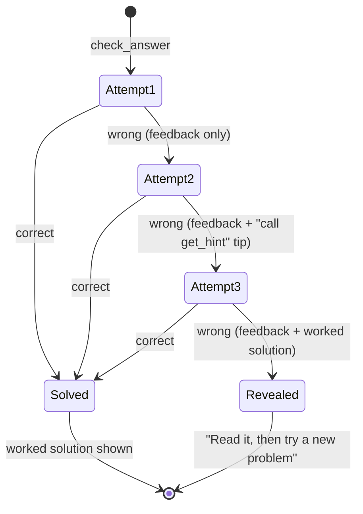

# Hint pedagogy

Most of this server is ordinary engineering. The parts on this page come from classroom teaching: how students actually get stuck, and what kind of help moves them forward without doing the thinking for them.

## The problem with "just ask the AI"

An AI model is very good at solving a Class 8 equation. That is the problem. If a student asks for help and gets the full solution, they have practised reading, not maths. Good tutoring gives the *smallest* nudge that gets the student moving again.

So the server is built around three ideas:

1. **Graduated hints.** Help starts general and gets more specific only when needed.
2. **Productive struggle.** The worked solution is held back until the student has made a real attempt.
3. **Specific feedback.** A wrong answer is not just "wrong"; where possible, the feedback names the likely mistake.

## Three levels of hints

Each problem has three hints. The `instructions` and the `socratic_tutor` prompt ask the model to start at level 1 and only go higher if the student is still stuck.

| Level | Purpose | Gives away |
| --- | --- | --- |
| 1 | Point to the right **method** or the key question. | Nothing about the numbers. |
| 2 | Do the **first step** with the real numbers. | One intermediate result. |
| 3 | Describe the **last step** as a question. | Everything except the final answer. |

Here are the real hints for three generated problems.

### `lin-g8-medium-42`: Solve for x: 7x + 7 = 105

1. "Undo the operations in reverse order: deal with the number added or subtracted first, then the multiplication."
2. "Subtract 7 from both sides. You should get 7x = 98."
3. "Now divide both sides by 7. What is 98 ÷ 7?"

### `frac-g7-medium-3`: Work out 1/4 + 11/12

1. "You can only add fractions when the denominators match. What is the lowest common multiple (LCM) of 4 and 12?"
2. "The LCM is 12. Rewrite both fractions over 12: 1/4 = 3/12 and 11/12 = 11/12."
3. "Add the new numerators, keep the denominator 12, then simplify."

### `quad-g10-hard-7`: Solve 3x² + 14x - 5 = 0

1. "Multiply a × c: 3 × -5 = -15. Find two numbers that multiply to -15 and add up to 14."
2. "The two numbers are 15 and -1. Split the middle term: 3x² + 15x - x - 5 = 0, then factorise in pairs (grouping)."
3. "You should end up with two brackets multiplied together equal to 0. Set each bracket to 0 and solve each small linear equation."

Notice that level 3 always leaves the student one real step to do. The test suite checks this for every generated problem: no hint may contain the final answer.

## Holding back the solution

`check_answer` counts attempts per problem:

- **Attempt 1 wrong:** specific feedback, no solution.
- **Attempt 2 wrong:** the feedback adds "Tip: call get_hint for a nudge before the next try."
- **Attempt 3 wrong:** the worked solution is shown. Struggling past this point usually leads to frustration rather than learning, so the student studies the method and moves on to a fresh problem.
- **Correct at any point:** the worked solution is shown, so the student can compare methods.

## Feedback that names the mistake

Many wrong answers in school maths come from a small number of well-known misconceptions. The generator predicts some of these wrong answers for each problem and attaches targeted feedback. These are real responses from the server:

| Problem | Student answer | Feedback |
| --- | --- | --- |
| `frac-g7-medium-3`: 1/4 + 11/12 | `3/4` | "It looks like you added the numerators and the denominators separately. Make the denominators the same first." |
| `pct-g8-hard-5`: after a 20% discount, a school bag costs Rs 240. Original price? | `288` | "You added 20% of the sale price, but the discount was taken from the original price, which is a bigger number." |
| `lin-g8-medium-42`: 7x + 7 = 105 | `-14` | "Check your signs: you have the right size of number but the wrong sign." |
| `quad-g10-hard-7`: 3x² + 14x - 5 = 0 | `1/3` | "One root is right. A quadratic like this has two roots; find the other one." |

The answer `3/4` for 1/4 + 11/12 comes from (1 + 11)/(4 + 12) = 12/16 = 3/4. The percentage example is the classic "reverse percentage" error: the student calculates 240 + 20% of 240 = 288, but the discount was 20% of the *original* price, which was Rs 300.

## Being kind about correct-but-unfinished answers

An answer can be mathematically right but not in the requested form. For `frac-g7-medium-3`, the answer `14/12` is marked **correct**, with a nudge:

> "Correct! Well done. Your value is right, but it is not in simplest form yet. Can you simplify it?"

Marking it wrong would punish the student for the part they got right. Marking it correct with no comment would miss a chance to teach. The server does both: it credits the work and asks for the last step.

## Context that feels familiar

Word problems use situations and money that students in Indian classrooms recognise: rupees (Rs), school bags, and the "Class 6–10" grade names used in Indian schools. Familiar context lowers the reading load, so students can focus on the maths.

## Further reading

- [Tools reference](../reference/tools.md) lists every feedback rule.
- [Security model](./security-model.md#2-no-answers-in-output) explains how the "no answers" rule is enforced.
