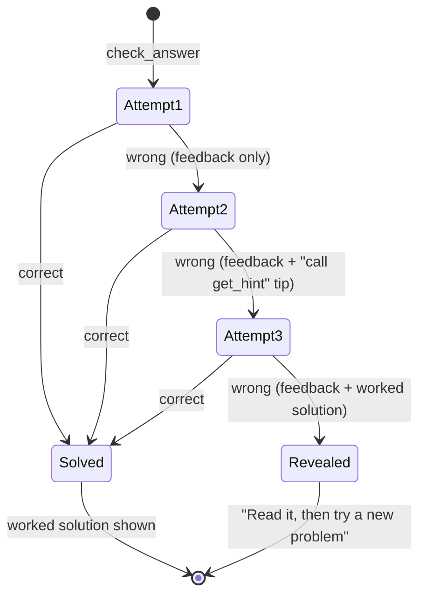

# Hint pedagogy

Most of this server is ordinary engineering. The parts on this page come from teaching quantitative aptitude and reasoning to CAT and other competitive-exam aspirants: how they actually get stuck, and what kind of help moves them forward without doing the thinking for them.

## The problem with "just ask the AI"

An AI model is very good at solving a CAT profit-and-loss or time-and-work question. That is the problem. If an aspirant asks for help and gets the full solution, they have practised reading, not problem solving, and the exam will not give them a solution to read. Good coaching gives the *smallest* nudge that gets the student moving again.

So the server is built around three ideas:

1. **Graduated hints.** Help starts general and gets more specific only when needed.
2. **Productive struggle.** The worked solution is held back until the student has made a real attempt.
3. **Specific feedback.** A wrong answer is not just "wrong"; where possible, the feedback names the likely mistake.

## Three levels of hints

Each problem has three hints. The `instructions` and the `socratic_tutor` prompt ask the model to start at level 1 and only go higher if the student is still stuck.

| Level | Purpose | Gives away |
| --- | --- | --- |
| 1 | Point to the right **method** or the key idea. | Little or nothing about the numbers. |
| 2 | Set up the **key step** with the real numbers. | At most one intermediate result. |
| 3 | Describe the **last step** as an instruction or question. | Everything except the final answer. |

Here are the real hints for three generated problems.

### `pl-hard-42`: By selling an article for Rs 800, a trader loses 20%. At what price should he sell it to gain 30%?

1. "Find the cost price first. A loss of 20% means Rs 800 is 80% of the cost price."
2. "To get the cost price, divide Rs 800 by 80 and multiply by 100."
3. "Now find 130% of that cost price."

### `work-hard-7`: Pipes A and B fill a tank in 6 and 24 hours; pipe C empties it in 8 hours. All three open: how long to fill?

1. "Filling pipes add water every hour; the emptying pipe takes some away."
2. "Take the tank as 24 units (the LCM of 6, 24 and 8). A adds 4, B adds 1 and C removes 3 units each hour."
3. "Find the net units filled per hour, then divide the size of the tank by it."

### `quad-hard-42`: Solve 4x² - 15x + 9 = 0

1. "Multiply a × c: 4 × 9 = 36. Find two numbers that multiply to 36 and add up to -15."
2. "The two numbers are -12 and -3. Split the middle term: 4x² - 12x - 3x + 9 = 0, then factorise in pairs (grouping)."
3. "You should end up with two brackets multiplied together equal to 0. Set each bracket to 0 and solve each small linear equation."

Notice that level 3 always leaves the student one real step to do. The test suite checks this for every topic and difficulty over many seeds: no hint may state the final answer.

### Hints for VARC items

Verbal items need a different rule, because a hint that names a sentence number or an option letter gives the answer away at once. VARC hints therefore never mention a number or a letter, and never quote the odd sentence or the correct option. They teach the reading move instead:

| Level | Para jumbles | Odd sentence out | Para summary |
| --- | --- | --- | --- |
| 1 | Find the opening sentence, the one that leans on no other. | Work out the single point most sentences develop. | Find the central claim; examples only support it. |
| 2 | Use pronouns and connectors: they come after what they refer to. | The odd one may share a keyword but goes somewhere else. | Eliminate options that are too narrow, too broad or distorted. |
| 3 | The shape of this paragraph, for example "from what a scheme is, to how it works, to its effects now and later". | The paragraph's main point, for example "the limits of recycling plastic". | The shape of this passage, for example "an old justification, why it has weakened, and what is changing". |

The tests check every VARC topic and difficulty over 100 seeds: no digits, no option letters, and no run of five words shared with the correct option or the odd sentence.

## Holding back the solution

`check_answer` counts attempts per problem:

- **Attempt 1 wrong:** specific feedback, no solution.
- **Attempt 2 wrong:** the feedback adds "Tip: call get_hint for a nudge before the next try."
- **Attempt 3 wrong:** the worked solution is shown. Struggling past this point usually leads to frustration rather than learning, so the student studies the method and moves on to a fresh problem.
- **Correct at any point:** the worked solution is shown, so the student can compare methods.

## Feedback that names the mistake

Many wrong answers in quantitative aptitude come from a small number of well-known traps, and exam setters build answer options around them. The generator predicts some of these wrong answers for each problem and attaches targeted feedback. These are real responses from the server:

| Problem | Student answer | Feedback |
| --- | --- | --- |
| `pl-hard-42`: sold at Rs 800 for a 20% loss; price for a 30% gain? | `1040` | "The gain % is worked out on the cost price, not on the old selling price." |
| `pct-medium-7`: Rs 8400, up 20%, then down 20%. Final price? | `8400` | "You combined the two percentages directly. The decrease is taken on the increased price, so apply the changes one after the other." |
| `tsd-medium-7`: P to Q at 104 km/h, back at 65 km/h. Average speed? | `84.5` | "That is the simple average of the two speeds. More time is spent at the slower speed, so the true average is lower." |
| `work-hard-7`: pipes of 6 h and 24 h fill, 8 h empties | `4.8` | "You left out pipe C, which is emptying the tank." |
| `quad-hard-42`: 4x² - 15x + 9 = 0 | `3` | "One root is right. A quadratic like this has two roots; find the other one." |
| `sum-medium-42`: para summary on museums returning colonial-era objects | `A` | "That option is true to the passage but covers only one detail or example, not the main point." |

The answer `1040` comes from taking 130% of the old selling price (800 × 1.3) instead of 130% of the cost price, which is Rs 1000. The `8400` answer is the classic "+20% then -20% cancels out" trap: the second change is taken on Rs 10080, so the price ends lower than it started. In para summary, each wrong option is built as one of the three classic CAT traps, a narrow detail, an overreach or a distortion, so the feedback names the trap without naming the right letter.

## Rewarding speed as well as accuracy

Competitive exams are timed, so a correct answer is not the end of the lesson. The feedback for a correct answer says "Now try to solve the next one faster", and the `socratic_tutor` prompt asks the model to discuss whether a shortcut or an elimination trick would also work once the student is right. The method comes first; speed is built on top of it.

## Context that feels familiar

Word problems use situations and money that Indian aspirants recognise: rupees (Rs), shopkeepers and discounts, trains and buses, pipes and tanks, and milk-water mixtures. These are the same settings that CAT-style and other competitive-exam questions use, so practice transfers directly to the exam.

## Further reading

- [Tools reference](../reference/tools.md) lists every feedback rule.
- [Security model](./security-model.md#2-no-answers-in-output) explains how the "no answers" rule is enforced.
