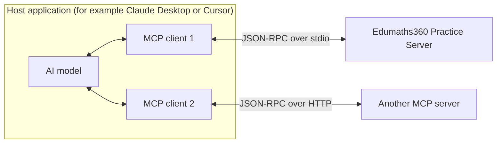
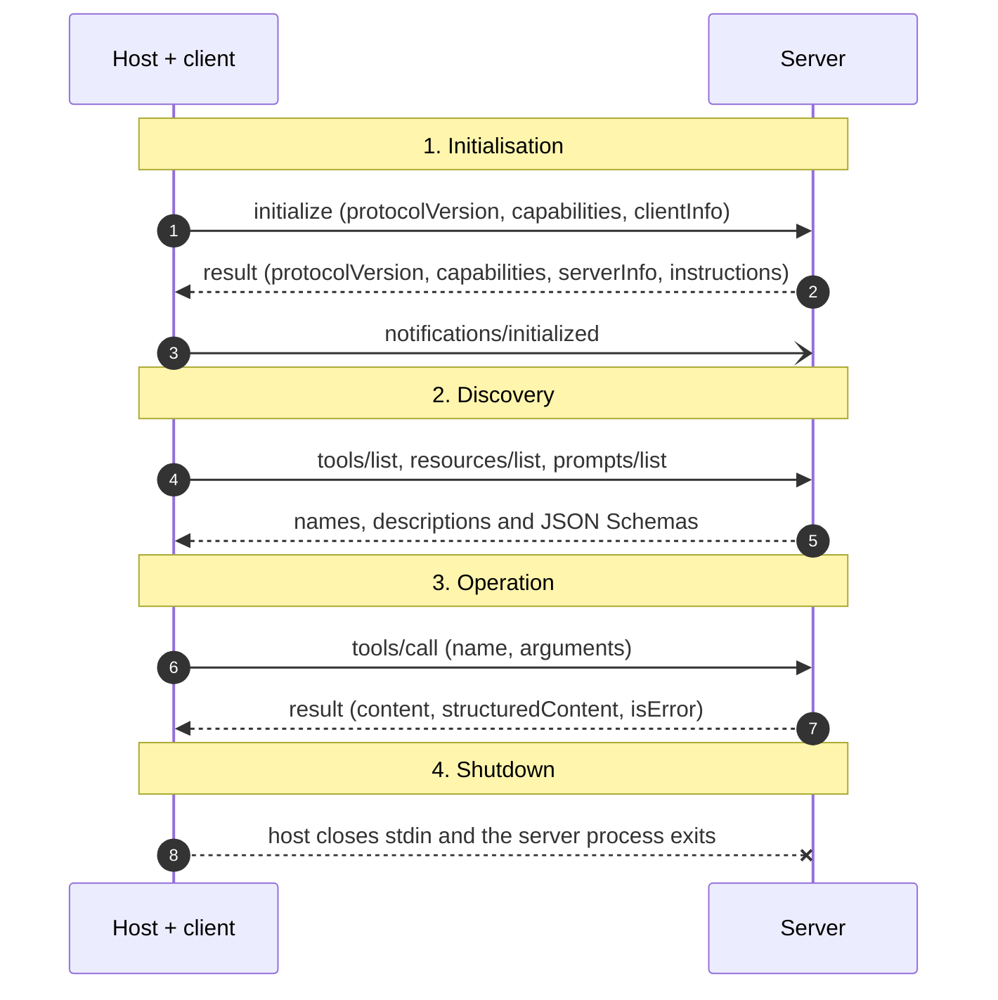

# How MCP works

The **Model Context Protocol (MCP)** is an open standard for connecting AI applications to tools and data. Before MCP, every AI app needed its own custom integration for every service. With MCP, a service writes one server, and any MCP-compatible app can use it.

## The three roles

| Role | What it is | In this project |
| --- | --- | --- |
| **Host** | The application the user works in. It runs the AI model, shows the chat and asks the user for permission. | Claude Desktop, Cursor, or the MCP Inspector. |
| **Client** | A component inside the host that holds **one** connection to **one** server. A host creates one client per server. | Built into the host. In `snippets/client.py`, the `Client` class from the Python SDK. |
| **Server** | A program that offers capabilities to the client. | The Edumaths360 Practice Server. |

The model never talks to the server directly. The model *asks* the host to call a tool, the host (often after asking the user) tells the client to send the request, and the result comes back the same way. This separation is what makes [human-in-the-loop control](./security-model.md#4-human-in-the-loop) possible.

## What a server can offer

MCP defines three main *primitives* that a server can provide:

| Primitive | Controlled by | Purpose | Edumaths360 example |
| --- | --- | --- | --- |
| **Tools** | The model | Actions the model can decide to take. | `generate_problem`, `check_answer`, `get_hint` |
| **Resources** | The application | Read-only data to load as context. | `syllabus://topics` |
| **Prompts** | The user | Ready-made templates the user picks. | `socratic_tutor` |

The "controlled by" column matters. A tool can be called whenever the model thinks it is useful. A prompt only runs when the user chooses it. Choose the primitive that gives the right person control.

## Transports: how messages travel

All MCP messages are [JSON-RPC 2.0](https://www.jsonrpc.org/specification) objects. The *transport* decides how they are carried:

- **stdio (standard input/output).** The host starts the server as a child process. Messages go to the server's stdin and come back on its stdout, one JSON object per line. There is no network port, so only the host can reach the server. The Edumaths360 server uses stdio.
- **Streamable HTTP.** The server runs as a web service and clients connect over HTTP. This suits remote and shared servers, and it needs authentication.

Because stdout *is* the channel on stdio, a server must never print anything else there. Logs go to stderr.

## The lifecycle of a connection

1. **Initialisation.** The client and server agree on a protocol version and say which features they support (their *capabilities*). The server can also send `instructions`, which hosts may give to the model. The Edumaths360 server uses them to say "do not solve the problem for the student".
2. **Discovery.** The client asks what the server offers. Each tool comes with a JSON Schema, which tells the model exactly what arguments are valid.
3. **Operation.** The model calls tools; the host reads resources and runs prompts.
4. **Shutdown.** On stdio, the host closes the server's input and the process ends.

Every one of these messages, as sent to the real server, is on the [JSON-RPC examples](../reference/json-rpc-examples.mdx) page.

### Protocol versions

MCP versions are dates. The handshake above, with `initialize`, is used by protocol versions up to `2025-11-25`. The `2026-07-28` revision adds a `server/discover` request that clients can use instead. The Python SDK 2.x client tries `server/discover` first and falls back to `initialize` for older servers, so you rarely need to think about it. The Edumaths360 server supports both, because the SDK handles negotiation.

## Why this design works well

- **Write once, use everywhere.** The same server works in Claude Desktop, Cursor and any other MCP host without changes.
- **Self-describing.** Schemas and descriptions travel with the tools, so the model learns how to use them at runtime.
- **Clear boundaries.** The server decides what is possible; the host decides what is allowed; the user stays in control.

Next: see how these ideas shape the [architecture of the Edumaths360 server](./architecture.md).
